# Swipe To-do App

> An AI-assisted frontend project built through iterative prompting, code review, and hands-on refinement.

## About the Project

I built this project to demonstrate how I use AI tools during frontend development—not just to generate code, but to review the output, understand implementation decisions, evaluate the result, and make targeted changes myself.

I used **Claude** as my AI development assistant. The prompts documented here were written by me. The project is still evolving, so this README records the development sessions completed so far and will be extended as new features are added.

I welcome feedback on the prompts, implementation, and overall user experience. Feel free to open an issue or submit a pull request with improvements.

## Project Preview

<!-- TODO: Add a screenshot of the final application -->

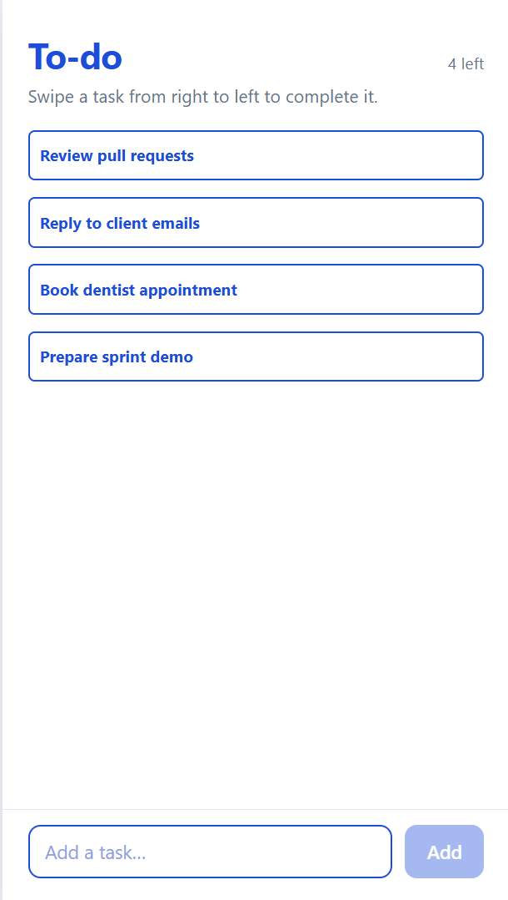

## Current Features

- Add tasks.
- Complete tasks by swiping from right to left.
- Undo completion by swiping from left to right.
- View incomplete and completed tasks in separate groups.
- Edit task names inline.
- Delete tasks with a confirmation dialog.
- Persist tasks using `localStorage`.
- Complete or undo tasks using the keyboard.
- Animated task transitions and reordering.
- Responsive, container-scaled interface.

> **Interaction note:** The edit/delete menu currently opens through the desktop right-click/context-menu interaction. The AI identified that this interaction is not consistently available on touch devices; a touch-friendly alternative remains a potential improvement.

## Tech Stack

- **React** — UI and component architecture
- **Vite** — development server and build tooling
- **JavaScript**
- **CSS** — styling, gradients, responsive sizing, and animations
- **Browser localStorage** — task persistence

## Development Journey

This project was developed in sessions. In each session, I described the desired behavior, reviewed the generated implementation, tested the result, and decided what to refine next. The sections below preserve that process rather than presenting the app as if it had been written in one pass.

---

## Session 1 — Building the Initial To-do App

### Goal

Build a simple React to-do app with a minimal white interface and a swipe-based interaction for completing tasks.

### My Prompt

> Act as a Senior Frontend Developer, build a simple to-do app.
>
> The frontend requirements are:
>
> 1. Background: white. Height to width ratio 16:9.
> 2. To-do card:
>    - The button should be rectangular. Height to width ratio 1:18, with rounded corners.
>    - The border should be 2px and blue. The original text colour should also be blue.
>    - The user should swipe from right to left. While swiping, show an animated green-to-white gradient from the right edge to the finger, leaving the rest of the card unchanged.
>    - When the swipe reaches the left edge, display “Completed” inside the card, with white text on a green background.
>    - After completion, animate the card to the right, then place it below all incomplete tasks.
> 3. Build the entire frontend in React.

### AI Response — Summary

Claude generated the initial React implementation and reported that the build passed. It also reported testing the app in headless Chromium using mouse drags, with no console errors. This was not a real-device touch test.

The initial implementation included:

- A white, centered application frame.
- Blue-outlined task cards with a green gradient that followed the swipe.
- A completion animation, followed by reordering the completed task below pending tasks.
- An add-task input, even though I had not explicitly requested it.
- `localStorage` persistence.
- Keyboard support using Enter or Space.

Claude also flagged a potential usability issue in my prompt: a card with a 1:18 height-to-width ratio could be very short on a phone. I chose to keep the ratio in the initial version and evaluate the result myself.

### AI Response — Original Output / Notes

<!-- TODO: Paste the relevant original AI response or link to the conversation here. -->

[Placeholder: AI response screenshot or excerpt]

### Results

| 1. Initial interface                                      | 2. Swipe gradient                                           |
| --------------------------------------------------------- | ----------------------------------------------------------- |
| 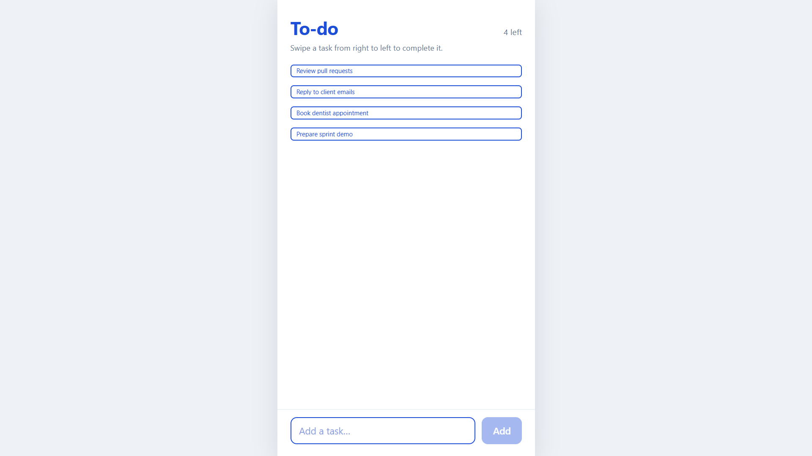 | 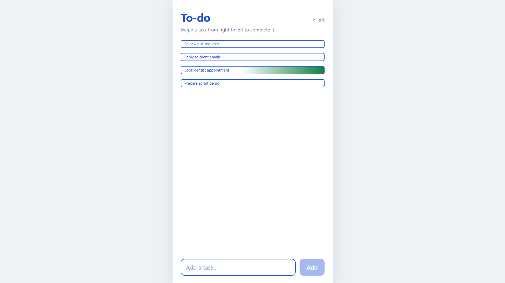 |

| 3. Completed task                                      | 4. Add-task feature                                     |
| ------------------------------------------------------ | ------------------------------------------------------- |
| 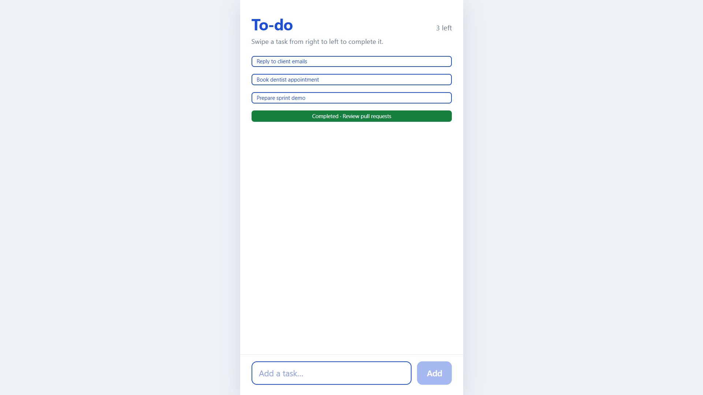 | 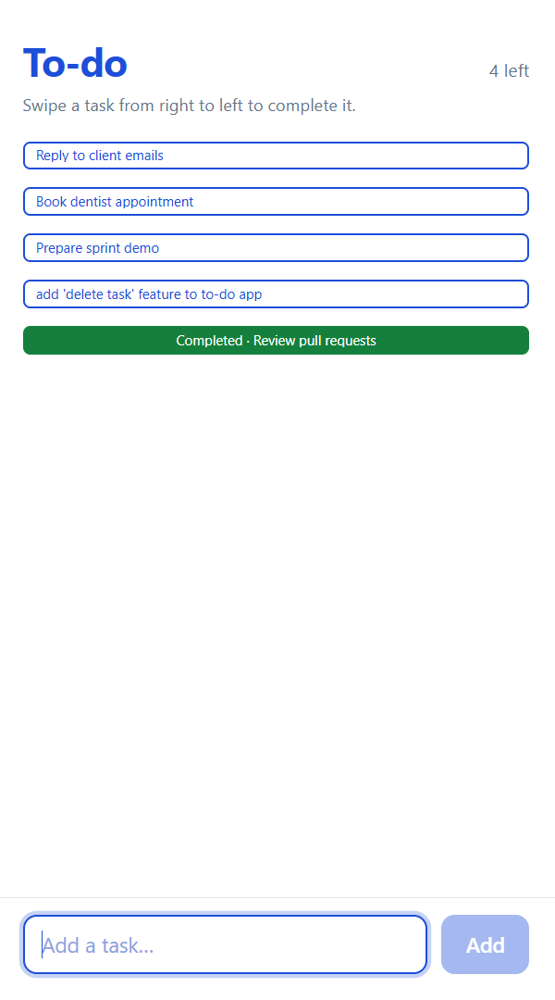 |

### My Evaluation

The first result largely matched my expectations. I particularly liked how the swipe interaction and completion animation were implemented. The AI also added an add-task feature and hint text that I had not explicitly included in my prompt.

Initially, I was unsure about displaying the task name alongside the word “Completed.” I later recognised that retaining the task name would be useful if I added an undo feature, because identical completed cards would otherwise be difficult to distinguish.

Overall, the first version was a good starting point, but the card height and text sizing needed refinement.

### Manual Changes

Rather than asking the AI to make every visual adjustment, I changed several CSS values myself:

- Increased the card height by adjusting its aspect ratio.
- Increased the font size to suit the taller card.
- Changed the label overflow behavior to prevent the lower parts of letters from being clipped.
- Increased the font size of the hint text.

These were subjective UI refinements based on inspecting the rendered result. They were also a useful opportunity to make small, targeted changes to AI-generated CSS directly.

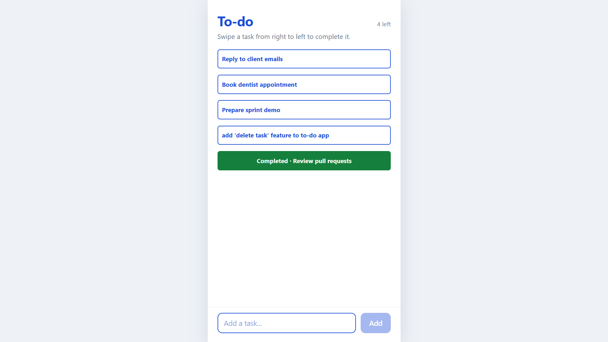

### What I Took Away

- A detailed prompt can communicate visual requirements and interaction behavior, but the rendered result still needs to be evaluated.
- An AI-generated implementation may include useful features beyond the explicit requirements.
- Small CSS changes can improve the usability and appearance of a generated interface without requiring a complete rewrite.
- Reviewing design decisions matters: the smallest possible card is not necessarily the most usable card.

### Next Steps

For the next session, I planned to add:

- Task deletion.
- Task editing.
- The ability to undo completion.

---

## Session 2 — Editing, Deleting, and Undoing Tasks

### Goal

Extend the app while preserving the existing implementation and the manual UI changes from the previous session.

### My Prompt

> _(I attached the updated project ZIP.)_
>
> Great work! I made some changes at my end. Review them and then continue with the below instructions.
>
> Continue assuming the role I assigned to you in the last prompt.
>
> I have planned 3 features:
>
> **1. Delete task:** Both incomplete and completed tasks can be deleted by right-clicking the task. A small dropdown appears with a delete option. Selecting it opens a confirmation popup containing: “Are you sure you want to delete the task: {task name}?”
>
> **2. Edit task:** Add another option to the dropdown to edit the task. For now, only the task name needs to be editable.
>
> **3. Undo completed task:** Add a reverse interaction for completed tasks. The user holds and swipes from left to right. A white-to-green gradient follows the cursor. Add the hint “Swipe a task from left to right to undo complete.” Make this interaction the reverse of the existing completion feature.
>
> Just give me updated files in copy-paste code. No need to send the entire ZIP file.

### AI Response — Summary

Claude reviewed the updated project, reinstalled dependencies in its working copy because the bundled `node_modules` was incompatible with its environment, and reported that the build and scripted checks passed in headless Chromium. Real touch devices and Safari were not tested.

The implementation added:

- A context menu with **Edit task** and **Delete task** options.
- A confirmation dialog before deleting a task.
- Inline task-name editing.
- A reverse swipe animation for undoing completion.
- A hint above the completed-task group, shown when completed tasks exist.
- Keyboard support for completing and undoing tasks.
- Animation adjustments to align the swipe overlay with the card border.
- A minimum swipe distance to reduce accidental completion.
- Preservation of the existing styling changes.

Claude also highlighted a platform limitation: right-click is not a reliable way to access edit/delete actions on touch devices. A long-press handler or a visible options button would make those features more accessible. This remained a potential improvement rather than part of the delivered implementation.

### AI Response — Original Output / Notes

<!-- TODO: Paste the relevant original AI response or link to the conversation here. -->

[Placeholder: AI response screenshot or excerpt]

### Results

| 1. Context menu                                         | 2. Inline editing                                      |
| ------------------------------------------------------- | ------------------------------------------------------ |
| 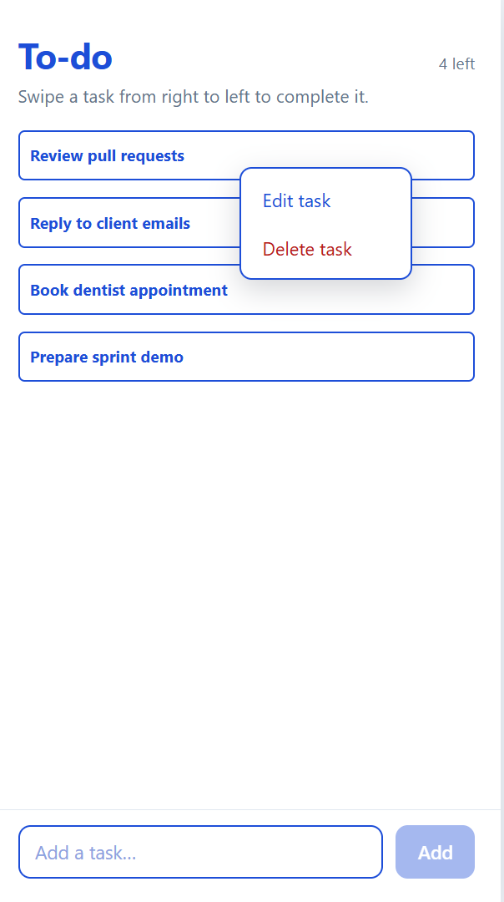 | 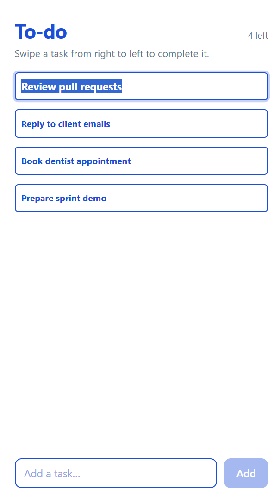 |

| 3. Delete confirmation dialog                                   | 4. Undo completion                                            |
| --------------------------------------------------------------- | ------------------------------------------------------------- |
| 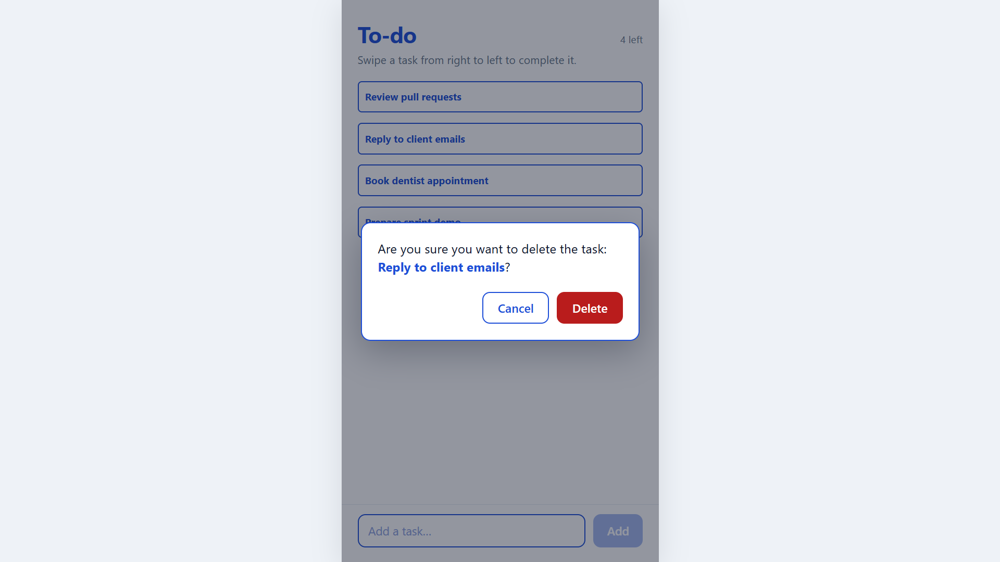 | 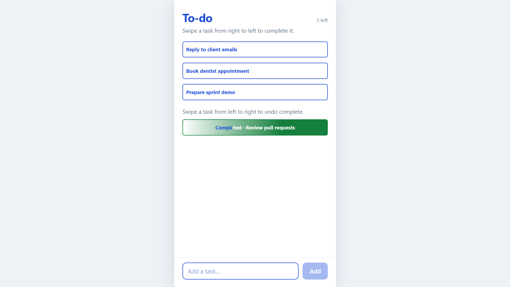 |

### My Evaluation

I was more impressed with the second result because I was unsure whether the AI would implement the reverse swipe interaction correctly. It successfully created a mirrored interaction and connected it to the task-reordering logic.

However, I noticed a few issues while reviewing the output:

- The text showed two colours during the undo swipe in a way that I did not want.
- The font size changed while editing a task.
- The entire task name was selected when editing began, whereas I wanted the text cursor at the end.
- The text colour during the undo interaction did not behave as expected.

These observations guided my next round of manual refinement.

### Manual Changes and Fixes

I made the following adjustments:

- Changed the editing font size to match the non-editing font size.
- Changed the editing cursor behavior so the cursor would start at the end of the task name rather than selecting the entire text.
- Continued refining the text colour behavior during the undo swipe.

| Edit feature changed                                        | Font colour change                                          |
| ----------------------------------------------------------- | ----------------------------------------------------------- |
| 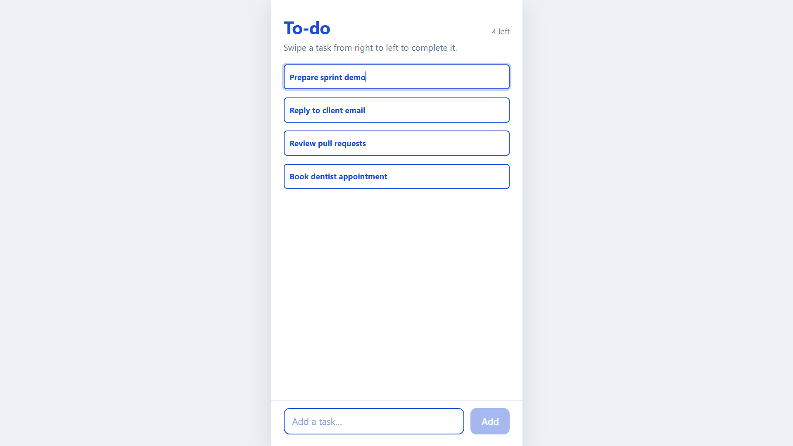 |  |

### What I Took Away

- Iterative prompting allows new functionality to be added without restarting from scratch.
- Reviewing generated code and testing the interface helps identify issues that are not obvious from the prompt alone.
- Small details—cursor placement, text colour, and font consistency—can make a noticeable difference to the user experience.
- AI-generated code still needs platform and accessibility review. In this case, the context-menu interaction needs a more touch-friendly alternative before the app can be considered fully usable on mobile.

### Next Steps

The next planned features are:

- Task dates.
- Task priorities.
- Filtering and sorting tasks.

---

## Implementation Notes

These are the main implementation choices visible in the current version of the project.

| Area             | Current approach                                                   |
| ---------------- | ------------------------------------------------------------------ |
| UI               | React components styled with CSS                                   |
| Task state       | React state in `App.jsx`                                           |
| Persistence      | Browser `localStorage`                                             |
| Completion       | Pointer-based right-to-left swipe                                  |
| Undo             | Pointer-based left-to-right swipe                                  |
| Editing          | Inline task-name editor                                            |
| Deletion         | Context menu followed by a confirmation dialog                     |
| Reordering       | Completed and pending tasks are grouped, with animated transitions |
| Keyboard support | Enter or Space completes/undoes a focused task                     |

### Component Structure

```text
src/
├── App.jsx
├── TodoCard.jsx
├── ContextMenu.jsx
└── ConfirmDialog.jsx
```

- **`App.jsx`** manages the task list, task creation, completion, undo, editing, deletion, persistence, and component coordination.
- **`TodoCard.jsx`** handles the card UI, swipe gestures, animation states, keyboard interaction, and inline editing.
- **`ContextMenu.jsx`** renders and manages the task options menu.
- **`ConfirmDialog.jsx`** displays the delete confirmation dialog.
- **`styles.css`** contains the visual styling, gradients, responsive sizing, and animations.

## Getting Started

### Prerequisites

- Node.js and npm installed.
- The project source code.

### Installation

Clone the repository and enter the project directory:

```bash
git clone <YOUR_REPOSITORY_URL>
cd <YOUR_PROJECT_DIRECTORY>
npm install
npm run dev
```

Open the local URL printed by Vite in your terminal.

> Do not include `node_modules` when sharing a project ZIP. Run `npm install` in the target environment to install dependencies for that environment.

## Feedback and Contributions

This project is an ongoing exploration of AI-assisted frontend development. Suggestions on prompt clarity, implementation, accessibility, component design, and user experience are welcome.

- Open an issue to report a bug or suggest an improvement.
- Submit a pull request with a proposed change.
- Share feedback on the prompts and whether they communicate the intended behavior clearly.

## Roadmap

- [ ] Add task dates.
- [ ] Add task priorities.
- [ ] Add filtering and sorting.
- [ ] Improve touch-device access to edit/delete actions.
- [ ] Continue documenting prompts, generated responses, manual refinements, and results as new sessions are completed.

## Author

**[Your Name]**

- GitHub: [Your GitHub Profile](YOUR_GITHUB_PROFILE_URL)
- Project: [Repository Link](YOUR_REPOSITORY_URL)
